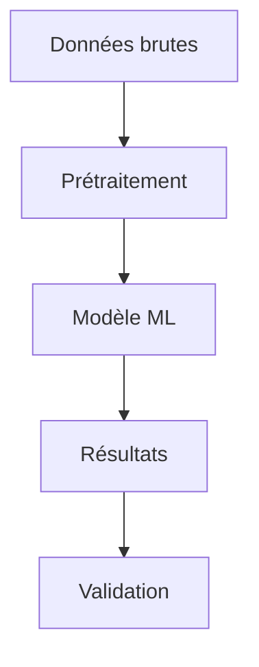
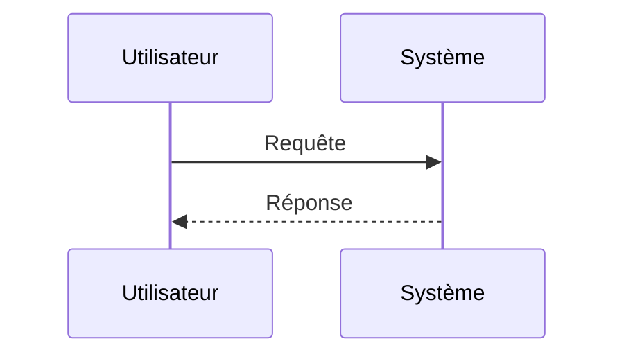

**template complet et prêt à l'emploi** pour un projet "Code + Documentation Markdown" optimisé pour GitLab et VSCode. C'est un setup hybride qui donne la souplesse du Markdown pour la rédaction quotidienne.

## 1. Structure du projet (à copier-coller)

Crée cette arborescence :

```bash
mkdir mon-projet && cd mon-projet
mkdir -p docs/{assets, styles} src tests scripts .vscode
touch README.md
touch docs/references.bib
touch docs/00-introduction.md
touch docs/01-etat-de-lart.md
touch docs/02-methodologie.md
touch docs/03-resultats.md
touch docs/04-conclusion.md
touch .gitignore
touch Makefile
touch .gitlab-ci.yml
```

**Arborescence finale :**
```
mon-projet/
├── README.md                 # Landing page GitLab (auto-rendu)
├── docs/                     # Toute la documentation
│   ├── references.bib        # Bibliographie (Zotero)
│   ├── 00-introduction.md
│   ├── 01-etat-de-lart.md
│   ├── 02-methodologie.md
│   ├── 03-resultats.md
│   ├── 04-conclusion.md
│   ├── assets/               # Images, schémas, captures
│   │   └── .gitkeep
│   ├── styles/               # Fichier de configuration
│   │   └── .apa.csl
│   └── template.tex          # Template LaTeX custom (optionnel)
├── src/                      # Code source
├── tests/                    # Tests unitaires
├── scripts/                  # Scripts utilitaires
│   └── build-pdf.sh
├── .vscode/
│   └── settings.json         # Config partagée équipe
├── .gitignore
├── Makefile                  # Commandes build
└── .gitlab-ci.yml            # CI GitLab (build auto PDF)
```

## 2. Configuration VSCode (`.vscode/settings.json`)

Colle ça dans `.vscode/settings.json` pour avoir un environnement pro :

```json
{
  // === MARKDOWN ===
  "[markdown]": {
    "editor.wordWrap": "on",
    "editor.quickSuggestions": {
      "other": true,
      "comments": true,
      "strings": true
    },
    "editor.snippetSuggestions": "top",
    "editor.formatOnSave": true,
    "editor.renderWhitespace": "none",
    "editor.minimap.enabled": false
  },

  // Preview Markdown améliorée
  "markdown.preview.breaks": true,
  "markdown.preview.fontSize": 14,
  "markdown.preview.fontFamily": "'Segoe UI', Tahoma, Geneva, Verdana, sans-serif",
  "markdown.preview.scrollEditorWithPreview": true,
  "markdown.preview.scrollPreviewWithEditor": true,

  // Liens et images
  "markdown.validate.enabled": true,

  // === BIBLIOGRAPHIE ===
  "zotero.autoExport": "onFocusChange",
  "zotero.autoExportPath": "${workspaceFolder}/docs/references.bib",
  "zotero.database": "group",  // ou "user" selon ton setup

  // === FICHIERS ===
  "files.exclude": {
    "**/.git": true,
    "**/.DS_Store": true,
    "**/node_modules": true,
    "**/*.pdf": false  // On veut voir les PDF générés
  },

  // === SPELL CHECK FRANÇAIS ===
  "cSpell.language": "fr,en",
  "cSpell.enabledLanguageIds": ["markdown", "latex", "plaintext", "python", "javascript"],
  "cSpell.dictionaries": ["french", "software-terms", "python"],

  // === PASTE IMAGE ===
  "pasteImage.path": "${currentFileDir}/assets",
  "pasteImage.prefix": "",
  "pasteImage.defaultName": "[img]-YYMMDDHHmm",
  "pasteImage.insertPattern": "",
}
```

**Extensions VSCode à installer** (je te donne les IDs exacts) :
```bash
code --install-extension yzhang.markdown-all-in-one
code --install-extension shd101wyy.markdown-preview-enhanced
code --install-extension streetsidesoftware.code-spell-checker
code --install-extension streetsidesoftware.code-spell-checker-french
code --install-extension mushan.vscode-paste-image
code --install-extension bierner.markdown-mermaid
code --install-extension eamodio.gitlens
code --install-extension mhutchie.git-graph
```

## 3. Setup Bibliographie (Zotero + Better BibTeX)

**Installation :**
1. Installe **Zotero** + **[Better BibTeX](https://retorque.re/zotero-better-bibtex/installation/)** (extension Zotero a télécharger puis Outils → Extensions → ⚙️ → Install plugin from file (zotero-better-bibtex-*.xpi)) 
2. Dans Zotero : Préférences → Better BibTeX → Export → **Garder à jour** → sélectionne ton `references.bib`
3. Dans VSCode : installe l'extension **Zotero LaTeX** (ou utilise le copier-coller)

**Workflow de citation :**
- Dans Zotero, sélectionne une référence → `Ctrl+Shift+C` (copie la clé BibTeX)
- Dans ton Markdown : colle `[@cle-biblio-2024]`
- Ou utilise l'extension VSCode "Zotero LaTeX" pour insérer directement

**Exemple de fichier `docs/references.bib` :**
```bibtex
@article{smith2024deep,
  title={Deep Learning for Computer Vision},
  author={Smith, John and Doe, Jane},
  journal={Nature},
  year={2024},
  volume={42},
  pages={123--145}
}

@book{knuth1984tex,
  title={The TeXbook},
  author={Knuth, Donald E},
  year={1984},
  publisher={Addison-Wesley}
}
```

**Utilisation du style apa**
```bash
curl -L -o docs/styles/apa.csl https://raw.githubusercontent.com/citation-style-language/styles/master/apa.csl
```

## 4. Template de document Markdown

Crée `docs/00-introduction.md` comme template pour tous tes chapitres :

```markdown
---
title: "Introduction"
author: "Ton Nom"
date: "26 octobre 2026"
bibliography: references.bib
csl: apa.csl  # Style de citation (télécharge depuis https://www.zotero.org/styles)
---

# Introduction

## Contexte

Le projet vise à [@smith2024deep]...

## Objectifs

1. Premier objectif
2. Deuxième objectif

## Plan du document

- [État de l'art](01-etat-de-lart.md)
- [Méthodologie](02-methodologie.md)

## Équations

Inline : $E = mc^2$

Bloc :
$$
\int_{-\infty}^{\infty} e^{-x^2} dx = \sqrt{\pi}
$$

## Diagramme Mermaid



## Image


*Figure 1 : Architecture globale*

## Références

Voir [@knuth1984tex] pour les détails théoriques.
```

## 5. La compilation html

Crée le script `compile-doc.sh` :

```bash
touch scripts/compile-doc.sh
```
Copie et colle ce contenue :

```makefile
#!/bin/bash

error="false"
# Créer le dossier de sortie
mkdir -p build

# Créer un lien symbolique vers docs/assets pour éviter ma duplication.
if [ -d "docs/assets" ]; then
    rm -f -r build/assets  # Supprime l'ancien lien s'il existe
    ln -s ../docs/assets build/assets
    echo "Lien symbolique créé: build/assets -> ../docs/assets"
fi

# Compiler chaque fichier markdown
for file in docs/*.md; do
    filename=$(basename "$file" .md)
    echo "Compilation de $filename..."

    pandoc "$file" \
        --bibliography=docs/references.bib \
        --csl=docs/styles/apa.csl \
        --citeproc \
        --standalone \
        --metadata title="Documentation" \
        -o "build/${filename}.html" || {
    echo "❌ Erreur lors de la compilation de $file"
    error="true"
    }
done

if [ "$error" = "false" ]; then 
    echo "✅ Compilation terminée dans ./build/"
else
    echo "❌ Erreurs lors de la compilation ="
fi
```

**Utilisation :**
```bash
source scripts/compile-doc.sh
```

## 6. README.md (Landing page GitLab)

```markdown
# 🚀 Nom du Projet

> Description courte du projet (1-2 lignes)

[](https://gitlab.com/ton-username/ton-projet/-/pipelines)
[](https://ton-username.gitlab.io/ton-projet/)

## 📋 Table des matières

- [Installation](#installation)
- [Utilisation](#utilisation)
- [Documentation](#documentation)
- [Structure du projet](#structure-du-projet)
- [Contribution](#contribution)

## 🛠️ Installation

```bash
# Cloner le repo
git clone https://gitlab.com/ton-username/ton-projet.git
cd ton-projet

# Installer les dépendances (si Python)
pip install -r requirements.txt

# Installer Pandoc pour la doc (Ubuntu/Debian)
sudo apt-get install pandoc texlive-xetex
```

## 💻 Utilisation

```bash
# Lancer le code
python src/main.py

# Générer la documentation PDF
make pdf

# Mode développement (recompile auto)
make watch
```

## 📚 Documentation

La documentation complète est dans le dossier [`docs/`](docs/).

| Chapitre      | Description             | Lien                            |
| ------------- | ----------------------- | ------------------------------- |
| Introduction  | Contexte et objectifs   | [Lire](docs/00-introduction.md) |
| État de l'art | Revue de littérature    | [Lire](docs/01-etat-de-lart.md) |
| Méthodologie  | Approche technique      | [Lire](docs/02-methodologie.md) |
| Résultats     | Expériences et analyses | [Lire](docs/03-resultats.md)    |

**📄 Télécharger le PDF complet** : [rapport.pdf](build/rapport.pdf) *(généré automatiquement)*

## 🗂️ Structure du projet

mon-projet/
├── docs/           # Documentation Markdown + Biblio
├── src/            # Code source
├── tests/          # Tests unitaires
├── scripts/        # Scripts utilitaires
└── Makefile        # Commandes de build

## 🤝 Contribution

1. Fork le projet
2. Crée une branche (`git checkout -b feature/ma-feature`)
3. Commit tes changements (`git commit -m 'Ajout de ma feature'`)
4. Push (`git push origin feature/ma-feature`)
5. Ouvre une Merge Request

## 📖 Références

Voir [docs/references.bib](docs/references.bib) pour la bibliographie complète.

---
*Dernière mise à jour : 27 octobre 2026*
```

## 7. CI GitLab (`.gitlab-ci.yml`)

Pour générer automatiquement le PDF à chaque push :

```yaml
pages:
  image: pandoc/core:3.1  # Image Docker avec Pandoc préinstallé
  stage: deploy
  script:
    - mkdir -p public
    # Compiler tous les .md en HTML avec bibliographie
    - |
      for file in docs/*.md; do
        filename=$(basename "$file" .md)
        pandoc "$file" \
          --bibliography=docs/references.bib \
          --citeproc \
          --standalone \
          --metadata title="Documentation" \
          --css=style.css \
          -o "public/${filename}.html"
      done
    # CSS simple
    - echo "body{font-family:Arial;max-width:800px;margin:40px auto;padding:20px;line-height:1.6} .csl-entry{margin-bottom:10px}" > public/style.css
    # Index automatique
    - echo "<h1>Documentation</h1><ul>" > public/index.html
    - for file in docs/*.md; do filename=$(basename "$file" .md); echo "<li><a href='${filename}.html'>${filename}</a></li>" >> public/index.html; done
    - echo "</ul>" >> public/index.html
  artifacts:
    paths:
      - public
  only:
    - main
```

## 8. Workflow quotidien recommandé

```bash
# 1. Démarrer la journée
git pull
code .  # Ouvre VSCode

# 2. Travailler sur la doc
# Édite docs/01-etat-de-lart.md
# Utilise Ctrl+K V pour la preview
# Colle les images avec Ctrl+Alt+V (elles vont dans docs/assets/)

# 3. Ajouter une référence
# Dans Zotero : Ctrl+Shift+C (copie la clé de citation)
# Dans VSCode : colle [@auteur2024]

# 4. Générer l'html pour vérifier
source scripts/compile.sh
start build/00-introduction.html

# 5. Commit
git add .
git commit -m "docs: ajout section méthodologie + 3 références"
git push
```

## 9. Astuces pro

**Raccourcis VSCode essentiels :**
- `Ctrl+K V` : Preview Markdown côte à côte
- `Ctrl+Shift+V` : Preview dans un onglet
- `Ctrl+Shift+P` → "Markdown: Export PDF" (via l'extension Preview Enhanced)
- `Alt+Z` : Word wrap on/off

**Gestion des images :**
- Toutes les images vont dans `docs/assets/`
- Référence : ``
- VSCode les affiche dans la preview

**Équations :**
- Inline : `$E = mc^2$`
- Bloc : `$$ ... $$`
- Preview VSCode : supporté nativement
- PDF : Pandoc convertit en LaTeX automatiquement

**Diagrammes :**
Utilise Mermaid (intégré) :

