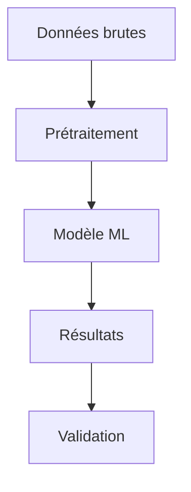

# Introduction

## Contexte

Le projet vise à ...

## Objectifs

1. Premier objectif
2. Deuxième objectif

## Plan du document

- [État de l'art](01-etat-de-lart.md)
- [Méthodologie](02-methodologie.md)

## Équations

Inline : $E = mc^2$

Bloc :
$$
\int_{-\infty}^{\infty} e^{-x^2} dx = \sqrt{\pi}
$$

## Diagramme Mermaid

## Image

## Références

Voir [@clédecitation] pour les détails théoriques.